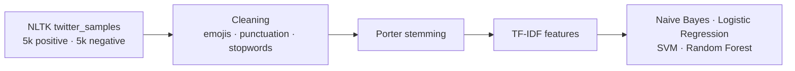
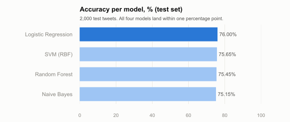

# 💬 Tweet Sentiment Classification

**Can classical machine learning tell a positive tweet from a negative one?**
NLP preprocessing → TF-IDF features → four models compared.

`10,000 labelled tweets` · `4 models` · `best accuracy 76%`

> This repository is a **project showcase**. Source code and the full report are private.
> Contact: albinajeti20@gmail.com

## Overview

| Stage | What I did |
|---|---|
| **1. Data** | Used NLTK's `twitter_samples` corpus: 10,000 tweets labelled positive or negative. |
| **2. Cleaning** | Removed emojis, punctuation and stopwords, lowercased the text and stemmed it. I tried Porter and Lancaster stemming and WordNet lemmatization; Porter worked best. |
| **3. Features** | Converted the text to TF-IDF vectors, with an 80/20 train/test split. |
| **4. Models** | Tuned and compared four classifiers using accuracy, precision, recall, F1 and confusion matrices. |

## Results

- **Logistic Regression** performed best with **76% accuracy**.
- All four models are within one percentage point of each other. With TF-IDF features, the choice of model matters less than the text representation.
- Naive Bayes classified negative tweets slightly better than positive ones (788 vs 715 correct).

## Next steps
- Try word embeddings or transformer models (e.g. BERT) that understand context and sarcasm
- Handle negation ("not good") explicitly during preprocessing

© 2025 Albin Ajeti. All rights reserved. See [LICENSE](LICENSE).
